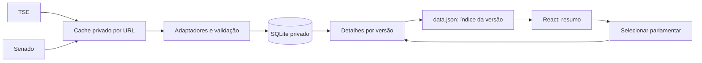

# Arquitetura de dados

A aplicação continua servida por arquivos estáticos. SQLite é o armazenamento privado da ingestão; o navegador recebe apenas o resumo e os detalhes publicados. Nenhum servidor de API é necessário nesta etapa.

Despesas históricas usam a tabela `expenses` no schema SQLite 3 e o comando `npm run ingest:expenses`. Detalhes públicos incluem totais em centavos, competências e categorias separados por Casa. A publicação preserva essas consultas em novas composições. Critérios e limites de cobertura: [DESPESAS.md](DESPESAS.md).

O índice também publica `resumosHistoricos`, com contagens, pendências e evidências, para cruzar os dados disponíveis sem baixar todos os detalhes. O frontend valida os vínculos e agrupa por Casa/período/critério, mostrando a cobertura do grupo. Esses cruzamentos parciais são distintos dos indicadores de cobertura completa; os indicadores permanecem nulos quando não atendem a esse contrato. Contagens por autor podem incluir o mesmo projeto em diferentes históricos.

Fotos: schema SQLite 4, tabela `photos`, comando `npm run ingest:photos` (`--offline` reutiliza perfis privados). URLs vêm dos campos oficiais `ultimoStatus.urlFoto` da Câmara e `UrlFotoParlamentar` do Senado, com vínculo de identidade previamente confirmado. A Casa da composição tem prioridade. O índice publica URL e evidência; o frontend carrega a imagem diretamente da fonte e a oculta se falhar. Ausência de foto não impede navegação nem demais dados.

O schema atual é 5: `norms` guarda as referências de lei verificadas na API da Câmara, com fonte e data. A ingestão aplica essas referências aos históricos/indicadores e as preserva ao reimportar arquivos sem URN. Confirmação exige ID/tipo/número/ano do projeto coincidentes e referência explícita à lei em despacho de transformação; o histórico de eventos exige código 251 e referência unívoca. Detalhes públicos guardam fonte e data dessa verificação complementar.

O schema atual passou a 6 com `reference_values` e `attendance`: subsídio normativo separado de pagamento individual e presença histórica por dia, separada por Casa/período/critério. O resumo contém contagens e cobertura, enquanto os detalhes mantêm os dias. `npm run ingest:attendance` valida a referência em duas fontes e confronta o detalhamento de presença com o resumo oficial. Falhas individuais preservam dados anteriores e ficam no relatório; sem nenhuma presença validada não há nova publicação. Cobertura parcial e limites: [SUBSIDIO-PRESENCA.md](SUBSIDIO-PRESENCA.md).



## Responsabilidades

| Arquivo | Responsabilidade |
| --- | --- |
| `backend/sources/composition.py` | Parse de TSE/Senado e validação da composição por UF |
| `backend/http.py` | Retentativas, cache por URL, paginação e escrita atômica |
| `backend/store.py` | Schema SQLite, identidades, candidaturas, mandatos, exercícios, execuções e snapshots |
| `backend/publish.py` | Geração de detalhes versionados e troca do índice por último |
| `scripts/ingest.py` | Orquestração e trava de execução por banco |
| `src/dataset.ts` | Contratos v1/v2, validação de indicadores e de detalhes |
| `src/App.tsx` | Resumo inicial e detalhes carregados apenas após seleção |

## Modelo

- `people`: identidade interna, separada da candidatura e do mandato.
- `identities`: identificação pública em cada fonte. É a correspondência usada na reimportação; nomes não são chave.
- `candidates`: candidatura eleitoral com pessoa, ano, casa e UF.
- `mandates`: cadeira/mandato com casa, UF e anos de início/fim.
- `exercises`: ocupante observado por mandato e snapshot, preservando mudanças e suplência.
- `indicators`: estrutura para indicadores por pessoa, casa, período, unidade, cobertura e fonte.
- `snapshots`: conjunto validado e versão histórica, com estado staged/published.
- `runs`: resultado de cada fonte e de falhas da composição.
- `artifacts`: hashes e localização dos arquivos brutos usados.

**Identidade entre fontes ainda não reconciliada:** cada identidade eleitoral/parlamentar recebe inicialmente uma identidade interna própria. IDs de candidatura do TSE não comprovam identidade da pessoa em outras eleições. Vínculos entre TSE, Câmara e Senado devem ser confirmados por evidência oficial e registrados antes de incorporar histórico de outra fonte. A separação do modelo prepara essa etapa; não afirma que a deduplicação entre fontes já aconteceu.

## Armazenamento e retomada

`var/painel.sqlite3`, cache e arquivos brutos ficam fora da publicação e do versionamento. O banco e os arquivos brutos têm permissões restritas; o ZIP bruto do TSE contém campos pessoais que não são exportados. Backups desse diretório devem permanecer privados.

O cache tem TTL padrão de uma hora e guarda apenas downloads concluídos. Falhas não ganham data nova usando respostas antigas. `--refresh` força nova consulta. Respostas com schema inválido são invalidadas pelo adaptador para permitir recuperação na próxima execução.

A paginação guarda cada resposta concluída por URL. Se uma página falhar, a execução seguinte pode reutilizar as páginas anteriores dentro do TTL. Ciclos e mudanças de origem são rejeitados. O cliente de paginação está preparado e testado; a coleta de projetos já está implementada; votações/despesas aguardam integração.

A composição precisa das duas fontes e mantém validação integral. Indicadores futuros devem ser jobs próprios, usando seu cache e estado de execução; falhar em um indicador não deve substituir ou invalidar a composição publicada.

SQLite usa chaves estrangeiras, transações e versionamento de schema (`user_version=2`). A CLI permite uma ingestão por banco de cada vez, usando trava de arquivo no Linux. Para execução distribuída ou muitos escritores simultâneos, reavaliar o armazenamento e a coordenação.

## Publicação consistente

1. Validar fontes e composição.
2. Gravar o snapshot e suas entidades em transação no SQLite.
3. Gerar todos os arquivos `public/data/snapshots/<versão>/<id>.json`.
4. Substituir `public/data.json` por escrita atômica, apontando para essa versão.
5. Marcar a versão como publicada no SQLite.

Os detalhes recebem a mesma versão e identidades do resumo. O frontend rejeita detalhes de outro parlamentar/versão. Uma falha durante geração deixa o índice anterior intacto; um snapshot staged pode ser republicado sem acessar a rede. Se a falha acontecer após a troca do índice, a versão já tem seus detalhes completos; a republicação recupera a marcação no banco.

`npm run ingest -- --export-only` republica o snapshot validado mais recente do banco. Pode incluir um snapshot staged cuja publicação anterior falhou. Versões antigas continuam disponíveis; remoção/retensão deve considerar leitores que ainda usam índices antigos.

## Contrato de indicadores

O schema v2 permite números somente com fonte oficial, período inicial/final, casa, unidade, cobertura completa, data de coleta e critério. Nulo continua significando indisponível. Os valores atuais continuam nulos: esta alteração não busca histórico nem inventa indicadores.

Indicadores com períodos, casas ou critérios diferentes não são somados. O detalhe mostra o período e critério; TXT/XLS incluem os metadados de indicadores. Projetos e listas extensas pertencem aos arquivos de detalhes, não ao resumo inicial.

## Operação e publicação em produção

```sh
npm run ingest
npm run test:data
npm run test:contract
npm run build
```

Um agendador de produção deve executar essas etapas em sequência e publicar **todo o `dist/`** somente se passarem. Nunca publicar apenas `data.json`, pois ele referencia detalhes da mesma versão. O provedor de hospedagem ainda não foi definido; nenhuma implantação ou tarefa externa foi criada.

Em hospedagem de arquivos estáticos, alterar `public/` no computador de ingestão não altera o site publicado. A atualização só chega ao usuário com uma nova publicação do `dist/`. Preservar a versão anterior até a nova release estar disponível, e configurar cache curto/revalidação para `data.json`; detalhes de versões podem ter cache longo. A estratégia exata de release e cache depende do provedor escolhido.

Para republicar sem rede:

```sh
npm run ingest -- --export-only
npm run build
```

## Testes

- `npm run test:data`: ingestão, completude, duplicidade, falhas, identidades, mudanças de ocupante, versões, cache, retomada e publicação.
- `npm run test:contract`: contratos TypeScript, detalhes de outro parlamentar/versão e indicadores com/sem evidência.
- `node scripts/check-prototype.mjs`: navegador, seleção, carregamento sob demanda, filtros, exportações, impressão, responsividade e erros de carregamento.

Histórico e vínculos já foram integrados para a cobertura descrita em `HISTORICO-LEGISLATIVO.md`. Tabelas `identity_evidence` e `histories` complementam o modelo; publicação de composição preserva o histórico confirmado no banco.
